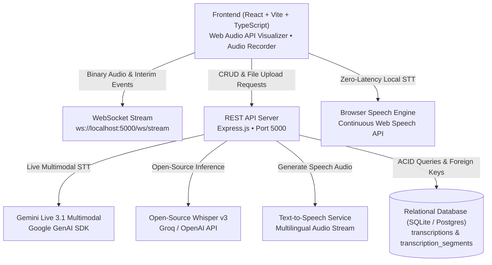

# 🎙️ VoxLingua AI — Real-Time Multilingual Speech-to-Text Studio
> **Procucev AI Tech Hiring Assignment — Assignment 1: Real-time Transcription**

A high-performance, full-stack real-time Speech-to-Text (STT) web application built specifically for **multilingual code-switching** (e.g., natural conversational **Hinglish** — a seamless blend of Hindi & English). Powered by an embedded **relational SQLite database** (with PostgreSQL compatibility), **Gemini Live 3.1 / 2.0 Multimodal API**, **Open-Source Whisper Large v3**, zero-latency **Browser Live Streaming**, and **Text-to-Speech (TTS)** playback.

---

## 🌟 Key Highlights & Requirements Fulfilled

| Requirement | Implementation in VoxLingua AI |
|---|---|
| **Real-time Transcription** | Zero-latency WebSocket streaming + continuous SpeechRecognition with interim token streaming. Words appear live on screen as you speak. |
| **Multilingual (Hindi + English / Hinglish)** | Specially tuned dual-engine recognition with automatic linguistic composition analysis (Devanagari script + Romanized Hinglish keyword detection with real-time % ratio bar). |
| **Relational Database** | Relational **SQLite** (`transcriptions.db`) configured with WAL mode, foreign key enforcement (`PRAGMA foreign_keys = ON`), composite indexes, and child table `transcription_segments` with `ON DELETE CASCADE`. (Also compatible with PostgreSQL via connection string). |
| **Full CRUD Operations** | **Create** (Live record & save / audio file upload), **Read** (Search, filter by language, sort, view segments), **Update** (Edit transcript text, title, tags, notes), **Delete** (Single item delete or bulk clear). |
| **Open-Source & Self-Deployed STT** | Supports **Gemini Live 3.1 / 2.0 Flash Multimodal** API, **Open-Source Whisper Large v3**, and offline Browser Continuous Streaming Engine. |
| **Text-to-Speech (TTS)** | Integrated multilingual TTS service for listening to transcribed sentences with natural Indian accent / Hindi voice. |
| **Rich Aesthetics** | Dark-mode glassmorphism UI, Google Fonts (`Outfit` & `Plus Jakarta Sans`), Web Audio API canvas frequency visualizer, and responsive layout. |

---

## 📐 Architecture & System Design



---

## 💾 Relational Database Schema

The database enforces relational constraints and foreign keys:

```sql
-- 1. Parent Table: transcriptions
CREATE TABLE transcriptions (
  id TEXT PRIMARY KEY,
  title TEXT NOT NULL,
  content TEXT NOT NULL,
  language_detected TEXT DEFAULT 'Multilingual (Hinglish)',
  language_code TEXT DEFAULT 'hi-en',
  duration_seconds REAL DEFAULT 0,
  word_count INTEGER DEFAULT 0,
  confidence_score REAL DEFAULT 0.95,
  engine_used TEXT DEFAULT 'Gemini Live Multimodal',
  audio_url TEXT,
  audio_data TEXT,
  status TEXT DEFAULT 'completed',
  tags TEXT DEFAULT '[]',
  notes TEXT DEFAULT '',
  created_at TEXT NOT NULL,
  updated_at TEXT NOT NULL
);

-- 2. Child Table: transcription_segments (Relational 1-to-Many)
CREATE TABLE transcription_segments (
  id TEXT PRIMARY KEY,
  transcription_id TEXT NOT NULL,
  segment_index INTEGER NOT NULL,
  start_time REAL NOT NULL,
  end_time REAL NOT NULL,
  speaker TEXT DEFAULT 'Speaker 1',
  text TEXT NOT NULL,
  detected_language TEXT DEFAULT 'hi-en',
  confidence REAL DEFAULT 0.95,
  FOREIGN KEY (transcription_id) REFERENCES transcriptions(id) ON DELETE CASCADE
);

-- Indexes for fast search & sorting
CREATE INDEX idx_transcriptions_created_at ON transcriptions(created_at DESC);
CREATE INDEX idx_transcriptions_lang ON transcriptions(language_code);
CREATE INDEX idx_segments_transcription_id ON transcription_segments(transcription_id);
```

---

## 🚀 Quick Start Guide

### Prerequisites
- **Node.js** (v18+ or v24+ recommended)
- **npm** (v9+)

### 1. Installation
Clone the repository and install all dependencies:
```bash
# Install root, backend, and frontend dependencies in one command
npm run install:all
```

### 2. Configuration (Optional)
The application works **100% out-of-the-box** using SQLite and the Browser Continuous Streaming Engine with zero API keys required.

If you wish to test with Google Gemini Live 3.1 or Groq Open-Source Whisper:
1. In `backend/.env` (or via the in-app ⚙️ Settings dialog):
   ```env
   PORT=5000
   GEMINI_API_KEY=your_gemini_api_key_here
   GROQ_API_KEY=your_groq_api_key_here
   ```

### 3. Run the Application
Start both the backend server and frontend development server with a single command:
```bash
npm run dev
```

- **Frontend App**: `http://localhost:5173` (or `http://localhost:5174`)
- **Backend API**: `http://localhost:5000`
- **WebSocket Stream**: `ws://localhost:5000/ws/stream`

---

## 📡 API Reference

### Transcriptions CRUD Endpoints
- `GET /api/transcriptions` — List/search transcriptions with query params (`search`, `language`, `sortBy`, `sortOrder`, `limit`, `offset`)
- `GET /api/transcriptions/:id` — Retrieve single transcription with relational child segments
- `POST /api/transcriptions` — Create a new transcription record
- `PUT /api/transcriptions/:id` — Update transcription (title, content, tags, notes)
- `DELETE /api/transcriptions/:id` — Delete transcription and its cascading segments
- `DELETE /api/transcriptions` — Clear all stored records

### Audio & AI Endpoints
- `POST /api/transcribe-audio` — Multipart file upload (`.mp3`, `.wav`, `.webm`, `.m4a`) or base64 audio transcription using Gemini or Whisper
- `POST /api/analyze-language` — Real-time linguistic analysis detecting Hindi vs English vs Hinglish composition ratio
- `POST /api/tts` — Text-to-Speech audio generation endpoint
- `GET /api/stats` — Aggregate metrics (total counts, total duration, word counts, language and engine breakdown)

---

## 🛠️ Tech Stack
- **Frontend**: React 18, TypeScript, Vite, Vanilla CSS Design System, Web Audio API, Lucide Icons
- **Backend**: Node.js, Express.js, WebSocket (`ws`), Multer, `@google/genai`
- **Database**: Relational SQLite (`better-sqlite3`) with WAL journal mode, Foreign Key enforcement, and relational schema migrations
- **Audio Processing**: Web Audio API `AudioContext` & `AnalyserNode` for real-time waveform visualization, Web MediaRecorder for live streaming chunks
